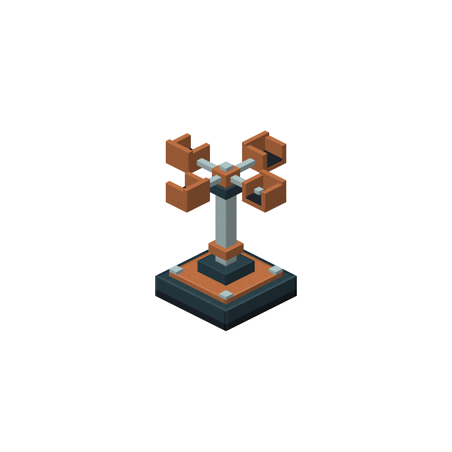
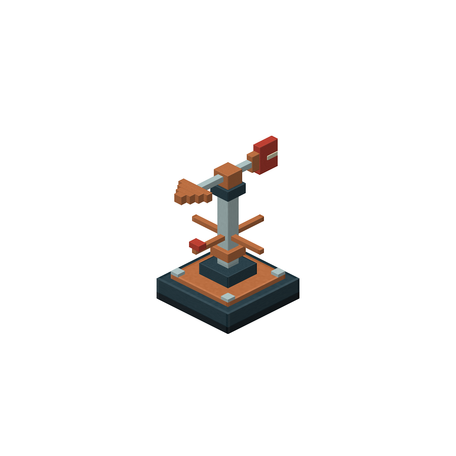
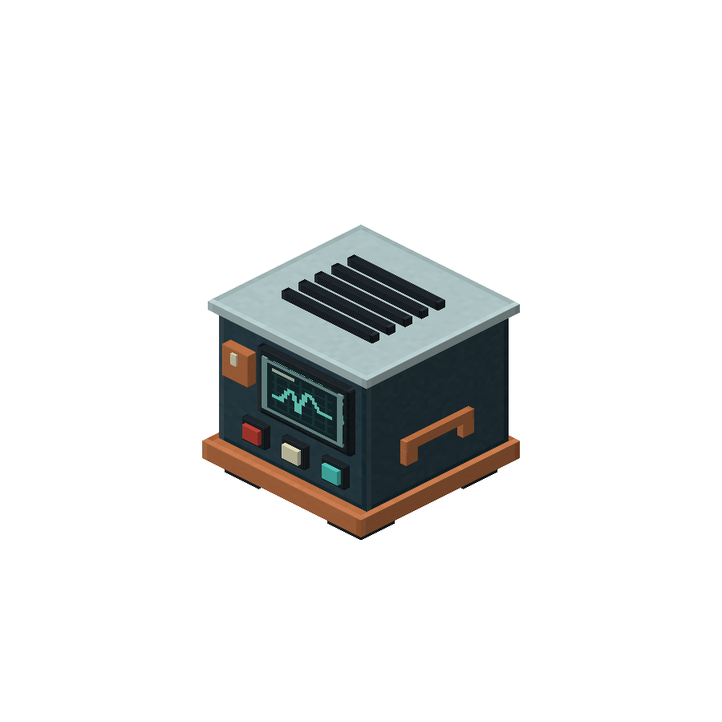
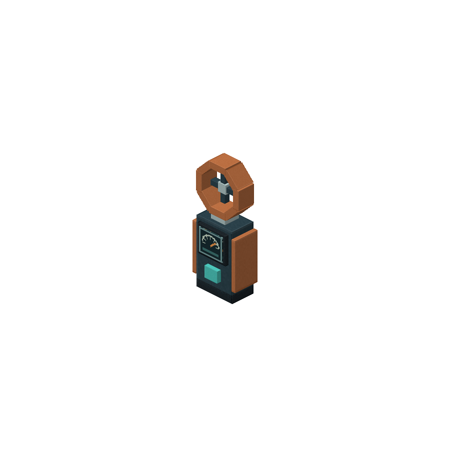

# 风律 · Windweave

**让天气、地形与风场共同影响 Minecraft 世界。**

Windweave 是一个面向 **Minecraft Java 1.21.1 / NeoForge** 的风场与环境效果模组。烟雾、雨雪、沙尘、草木、水面、投射物和实体共享同一套风场，玩家也可以用仪器测量风况、用风场改变器控制局部气流。

[](https://github.com/ikunkk02-afk/Windweave/actions/workflows/build.yml)
[](LICENSE)

| 项目 | 当前版本 / 要求 |
| --- | --- |
| Windweave | **0.6.2** |
| Minecraft | **1.21.1** |
| 加载器 | **NeoForge 21.1.265 或更新的 21.1 系列版本**；实测 21.1.265 |
| Java | **21** |
| 网络协议 | **6**；联机客户端与服务器需安装兼容版本，建议统一使用 0.6.2 |

## 功能

- **自然风与天气**：晴天、降雨、雷暴拥有不同风况；罕见极端阵风平滑增强和消退。
- **地形导流与遮风**：墙后风力减弱，离开遮挡后逐渐恢复；狭窄高墙通道可加速、引导气流。
- **风力物理**：烟雾、火苗、普通碎屑、掉落物和投射物受风影响；玩家与普通生物仅在较强风中受推力，极端风可抬升。
- **立体天气**：随风倾斜的粒子雨、翻转雪花、地面飞沫，以及沙漠扬沙和沙尘暴。
- **环境表现**：动态风声、天气雾、原版渲染下的草木摆动、火焰弯曲与水面风纹。
- **风火联动**：风可影响顺风蔓延和强风熄灭，遵守 `doFireTick`。
- **仪器与控制**：风速仪、风向标、手持风速检测仪，以及能够建立局部风场或无风区的风场改变器。
- **可关闭的风线**：可在设置中永久隐藏风向指示，也可用命令临时切换。

这些是可调的游戏效果和地形近似，不是完整流体动力学或现实人体气动模拟。

## 安装

1. 准备 Minecraft **1.21.1**、NeoForge 和 Java **21**。
2. 获取编译后的 `windweave-0.6.2.jar`，放入对应游戏实例的 `mods` 文件夹，移除旧版 Windweave JAR。
3. 联机时，在客户端和服务器都安装模组。升级不需要删除原有配置或存档。

源码可按下文自行构建，也可以前往 [Actions](https://github.com/ikunkk02-afk/Windweave/actions/workflows/build.yml)，选择成功的构建，在 **Artifacts** 中下载 `Windweave-NeoForge-1.21.1` 并解压取得 JAR。下载 Actions 构建产物可能需要登录 GitHub。

本仓库当前提供 **NeoForge** 实现，没有 Fabric 版本。

## 仪器

全部仪器提供合成配方，并出现在“**风律 · 仪器与风场**”创造物品栏中。

| 风速仪 | 风向标 | 风场改变器 | 手持风速检测仪 |
| :---: | :---: | :---: | :---: |
|  |  |  |  |
| 风杯随当地风速旋转，右键读取风况。 | 箭头随当地气流转向，表示风吹去的方向。 | 右键打开界面，设置方向、风速、半径和启停。 | 右键在聊天中读取当地风速、方向与等级。 |

风场改变器可设置 **0–80 m/s**、**8–64 格**半径；中心区域接近设定风，边缘平滑融合。设为 0 可建立无风区，停用或移除后恢复环境风场。设置随方块保存。

模型可编辑源文件和预览位于 [art/instruments](art/instruments)。手持仪器表盘是静态美术图案，实际风况通过右键读取；模组不显示风速 HUD。

## 命令

| 命令 | 用途 |
| --- | --- |
| `/windweave` 或 `/windweave status` | 查看本维度环境风和当前位置风况 |
| `/windweave auto` | 恢复自然风 |
| `/windweave calm` | 将本维度固定为无风 |
| `/windweave set east 12` | 固定向东吹的 12 m/s 风 |
| `/windweave set west 30` | 固定向西吹的 30 m/s 风 |
| `/windweave set 45 12` | 按角度指定风向与风速 |
| `/windweave flow off` / `/windweave flow on` | 临时隐藏 / 开启自己的风线 |

改变维度风场需要作弊权限或服务器管理权限；状态查询和个人风线命令不要求管理权限。

方向表示**空气吹去的方向**：北 0°、东 90°、南 180°、西 270°。固定风的风速范围为 0–80 m/s，地形加速后的局部风速可能更高。

## 关闭风向指示与其他设置

在游戏中打开 **模组 → Windweave → 设置 → 风与环境显示**，关闭“**风向指示（流动风线）**”即可隐藏风线。设置会保存，不影响风物理、粒子或仪器。

也可以修改客户端文件 `config/windweave-client.toml`：

```toml
windDirectionIndicator = false
```

这个设置是风线的总开关。关闭后，`/windweave flow on` 也不会显示风线；重新开启设置后，仍遵守当前会话的命令开关。

其他常用选项：

| 配置范围 | 选项 |
| --- | --- |
| 客户端 `windweave-client.toml` | 草木、水纹、火焰、粒子雨雪、飞沫、沙尘、天气雾、风声与音量 |
| 世界服务端 `serverconfig/windweave-server.toml` | 自然风速、遮挡、地形导流、玩家/生物受风、掉落物、投射物与风火联动 |

单人世界的服务端配置通常位于 `saves/<世界名>/serverconfig/`，专用服务器位于对应世界目录的 `serverconfig/`。

### 行走阻力与雷暴平衡

默认普通降雨的风速低于实体受风门槛 **16 m/s**，不会因为这部分风力而拖慢走路。地面强风推力较轻，潜行可进一步减弱受力；水中、熔岩、乘坐、睡眠、旁观模式和创造飞行跳过实体风力。

自然雷暴多数时间约为 **14–22 m/s**。每个两分钟窗口约 **6%** 概率安排罕见极端阵风：**20 秒渐强 → 80 m/s 峰值持续 2 秒 → 32 秒回落**。天气强度、地形和遮挡会影响当地读数；固定命令和改变器仍可覆盖自然风。

## Sodium、Iris 与光影

| 环境 | 当前支持范围 |
| --- | --- |
| 原版 NeoForge 渲染 | 模组地形动画、粒子、仪器和服务端物理 |
| 仅 Sodium，或 Iris 关闭光影 | 物理、仪器、声音、风线和粒子可用；草木/水面的 GPU 风动画尚未移植到 Sodium 的原生区块程序 |
| Sodium + Iris + 已适配的 iterationRP | 通过 Iris 接口让草木、火焰、水面风纹跟随模组风场 |
| 其他未适配光影 | 保留光影自己的动画；这些动画不会自动跟随模组风场 |
| Embeddium / Oculus | 保留已有回退逻辑，本轮未验证专用适配 |

已在本机检查过 **Sodium 0.8.13+mc1.21.1 + Iris 1.8.14-beta.1+mc1.21.1**。Iris 接口说明见 [docs/iris-wind-interface.md](docs/iris-wind-interface.md)。

### iterationRP 本地适配

适配目标为 **iterationRP Alpha 0.8.26 hotfix**，需要你自行准备原始光影 ZIP。运行：

```shell
python scripts/patch-iteration-wind.py "iterationRP Alpha 0.8.26 hotfix.zip" "iterationRP-Windweave.zip"
```

然后将新 ZIP 放入实例的 `shaderpacks`，在 Iris 中选择它。脚本校验原文件版本并生成副本，不覆盖原包。已有带 **Windweave 0.6.0** 后缀的私人兼容副本也可继续使用。

仓库不提供原光影或修改版下载。iterationRP 由 **Tahnass** 制作，原包许可允许私人修改、限制再分发；生成的副本仅供本地使用，MIT 许可不覆盖该光影。

兼容光影目前以相机附近的平滑风场代表可视区域，以光照近似植物遮挡；远处不同局部风场并非逐顶点精确采样。水面保留光影自身的法线与视差实现。

## 从源码构建

安装 JDK 21 后运行：

```powershell
# Windows
.\gradlew.bat build
```

```shell
# Linux / macOS
./gradlew build
```

首次构建需要联网下载 Gradle、Minecraft 和 NeoForge 依赖。产物位于 `build/libs/`。

| 开发任务 | Gradle 任务 |
| --- | --- |
| 开发客户端 | `runClient` |
| 无界面服务端 | `runServer` |
| 服务端 GameTest | `runGameTestServer` |
| 普通雨天行走对照 | `runBodyWindClientTest` |
| 仪器、控制器、实体受风和资源重载 | `runStormDevicesClientTest` |

运行真实客户端测试前，先完成 `runGameTestServer`，再在 Windows 执行 `scripts/prepare-client-test.ps1`。测试在项目内的独立测试世界运行，生成报告后退出；这不是自己的正式游戏存档。开发测试类不会打入发行 JAR。

构建与检查记录：本机服务端 8 项 GameTest 通过；0.6.1 的真实键盘行走对照中，无风与雨中 14 m/s 逆风在相同 40 刻内均移动约 8.375 格；极端受风与资源重载检查通过。0.6.2 风线开关已编译验证，尚未单独完成界面点击验收。GitHub Actions 当前执行构建并上传 JAR，不包含图形客户端测试。

## 已知边界与反馈

地形遮挡、峡谷加速和风火行为均为游戏近似。尚未完成远程多人完整验收、大型森林/沙漠 FPS 基准，或所有第三方渲染器、光影和维度组合的验证。

反馈问题请提交到 [Issues](https://github.com/ikunkk02-afk/Windweave/issues)，附上 Minecraft、NeoForge、Windweave 和相关渲染模组版本、使用的光影名称、复现步骤及相关日志。

历史版本与实现记录见 [CHANGELOG.md](CHANGELOG.md)。本仓库只追踪源码、原创资源、模型与构建工具；本地构建缓存、测试存档和私人光影副本不上传。

## 许可与致谢

- 项目代码与原创资源使用仓库 [MIT 许可证](LICENSE)。
- NeoForge MDK 模板许可证保留在 [TEMPLATE_LICENSE.txt](TEMPLATE_LICENSE.txt)。
- 风声来源为 **SketchMan3** 的 CC0 素材；来源与加工方式见 [WIND_AUDIO_CREDITS.md](src/main/resources/WIND_AUDIO_CREDITS.md)。
- Minecraft、NeoForge、Sodium、Iris 及第三方光影属于各自作者，本仓库的许可不替代它们的许可。
